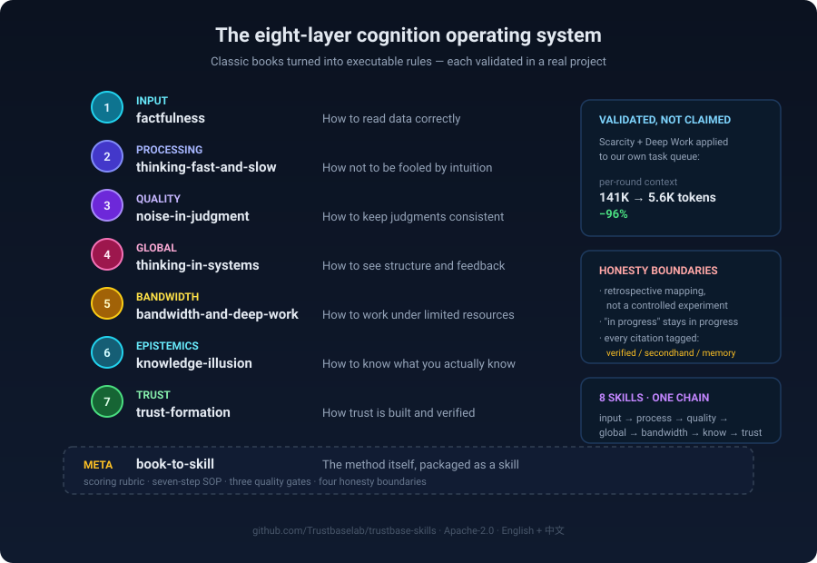

# Trustbase Skills

**8 skills that turn classic books into executable rules for AI agents.**
**Not summaries — if a sentence can't become "when X, do Y", it doesn't go in.**

[](https://skills.sh/Trustbaselab/trustbase-skills)
[](LICENSE)
[](#skills)
[](https://trustbaselab.com/database)

```bash
npx skills add Trustbaselab/trustbase-skills
```

**Quick nav**: [What is this](#what-is-this) · [The 8 skills](#the-8-skills) · [Why different](#why-this-is-different) · [Install](#install) · [Feedback](#feedback)

---



## What is this

**Cognitive skills** — rules an AI agent can actually execute, derived from classic books.

Each one was validated in a real project. The clearest example: applying *Scarcity* + *Deep Work* to our own task queue cut per-round context from **~141K tokens to ~5.6K (−96%)**.

There is also a meta-skill, `book-to-skill`, which packages **the method of turning a book into a skill** — including a scoring rubric for book selection, a seven-step SOP, and a delivery checklist.

**The design rule everything follows:** if a sentence from the book cannot be translated into "when X, do Y", it does not enter the skill. That rule filtered out about 60% of what we initially wanted to include.

---

## The 8 skills

| Skill | Answers the question |
|---|---|
| `factfulness` | **Is this number trustworthy?** |
| `thinking-fast-and-slow` | **Is this AI conclusion reliable — or just fluent?** |
| `noise-in-judgment` | **Why does the answer change every time?** |
| `thinking-in-systems` | **Why does fixing it make it worse?** |
| `bandwidth-and-deep-work` | **Why can't I focus, and what do I do first?** |
| `knowledge-illusion` | **Do you actually know this, or just remember it?** |
| `trust-formation` | **Why should anyone trust this?** |
| ⭐ `book-to-skill` | **How do I turn a book into a skill myself?** |

**Each skill ships four things:**

```
<skill>/
  SKILL.md                  # triggers + if-then rules + counter-examples
  references/<book>-book.md # our own summary of the ideas (no verbatim excerpts)
  references/evidence.md    # before/after data from a real project
  METHOD.md                 # how this specific book was converted
```

**Also included:** 6 industry skills covering the recycled-carbon-black chain, carbon compliance and compute energy efficiency. All of them query a live MCP server with 59 tools and 5,470 verifiable facts:

| Skill | Question it answers |
|---|---|
| `rcb-grade-identification` | What grade is this batch of rCB? Which R-code? |
| `rcb-substitution-assessment` | Can rCB replace N550 / N330 / N660? What ratio ceiling? |
| `rcb-price-reference` | What is a reasonable price band? (anchor-derived, not a quote) |
| `rcb-export-compliance` | What does exporting to the EU require? |
| `carbon-cbam-cost-calc` | **Is this product even in CBAM scope?** Then: what does it cost? |
| `compute-pue-benchmark` | **What caliber is this PUE?** Then: is it good? |

**Design principle:** each skill is *process + constraints*, never data. Every number is fetched at runtime from MCP, and every citation must carry a record ID, a confidence level (A/B/C) and an `as_of` date. Where this site has no coverage, the skill is required to say so rather than fill the gap from general knowledge.

---

## Why this is different

| Typical skill repo | This repo |
|---|---|
| Reading notes, reworded | **Rules that pass an if-then test, or they don't ship** |
| "This should work" | **Before/after data from a real project, or it stays at v0** |
| Cites books vaguely | **Every citation carries a provenance status** (below) |
| Skill text is the product | **Skill + verifiable source is the product** |

### The provenance rule

Every citation carries one of three states:

| State | Phrasing | May be used as |
|---|---|---|
| **Verified** | "Book p.XX: …" | ✅ "the book says" |
| **Secondhand** | "according to X, Y says" | ⚠️ secondhand |
| **From memory** | "our understanding is (pending verification)" | ⛔ **never** as "the book says" |

**We added this rule after getting it wrong ourselves** — we once wrote "Botsman proposes that trust has four elements" from memory, with no page number. Someone corrected us. The rule now lives in `book-to-skill` as Rule 2b. **If our own evidence is dishonest, nothing else we do counts.**

---

## Install

```bash
npx skills add Trustbaselab/trustbase-skills              # all skills
npx skills add Trustbaselab/trustbase-skills@factfulness  # one skill
```

**Any agent that supports the [Agent Skills spec](https://agentskills.io)** can use these — `SKILL.md` plus YAML frontmatter is all it needs.

<details>
<summary>Other install methods</summary>

**DSH**:
```bash
git clone https://github.com/Trustbaselab/trustbase-skills.git
cp -r trustbase-skills/cognitive/* ~/.dsh/skills/
```

**Claude Code**:
```bash
/plugin marketplace add Trustbaselab/trustbase-skills
```

</details>

---

## Data source

The industry skills query the Trustbase Lab MCP server:

```
https://trustbaselab.com/mcp
```

- **59 tools** · **520+ cross-domain benchmarks** · **2,738 records**
- **Every fact carries**: stable ID · confidence A/B/C · `source_url` · `as_of` · a verification URL
- **Registry**: `com.trustbaselab/rcb-data`

---

## Language

**English first.** Chinese editions are preserved in every skill as `references/SKILL.zh.md`.

---

## Integrity

- **Apache-2.0** — see [LICENSE](LICENSE)
- **`SHA256SUMS`** published; cross-check against https://trustbaselab.com/skills/
- **Only two official channels**: this repo and that page. For any other source, verify the sha256 first.

---

## Feedback

**This is v1.5.0, released 2026-10-18.** It has been used inside one project so far — ours.

**If you try it and something breaks, or you think the whole approach is over-engineered, please [open an issue](../../issues).** Both are useful.

**If you want to contribute a skill**, start with [`template/BOOK-TO-SKILL-CHECKLIST.md`](template/BOOK-TO-SKILL-CHECKLIST.md) and [`cognitive/METHOD.md`](cognitive/METHOD.md).

---

## Links

- **Data platform**: https://trustbaselab.com
- **MCP endpoint**: https://trustbaselab.com/mcp
- **Usage board**: https://trustbaselab.com/usage/
- **Corrections**: https://trustbaselab.com/corrections/
- **Skills page**: https://trustbaselab.com/skills/
- **Agent Skills spec**: https://agentskills.io

---

*Based on the ideas of published books; sources are noted inside each skill. We do not reproduce or translate excerpts of the originals. This repository does not provide investment, legal, or customs-declaration advice.*
