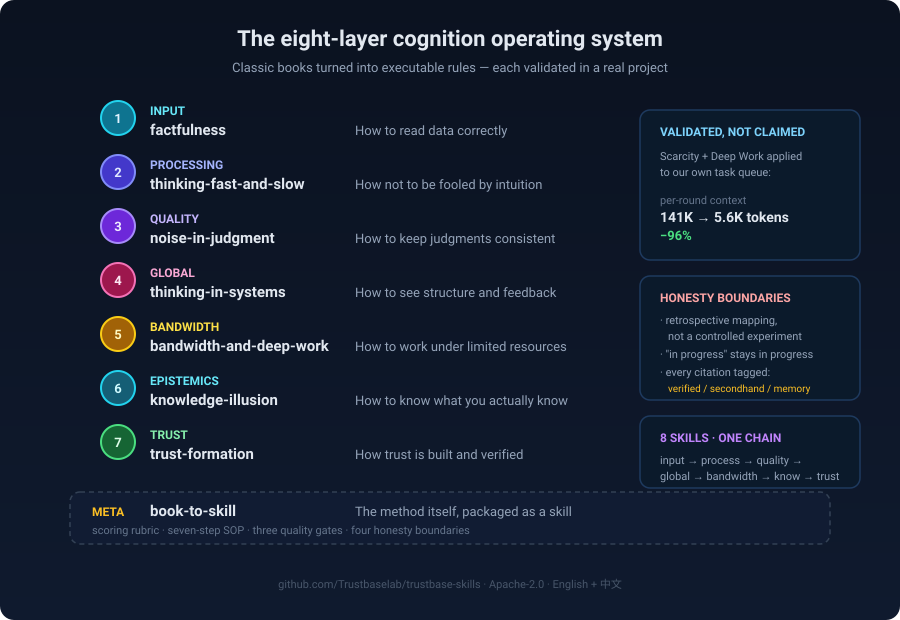

# Trustbase Skills

**12 cognitive skills that turn classic books into executable rules for AI agents.**
**Not summaries — if a sentence can't become "when X, do Y", it doesn't go in.**

[](https://skills.sh/Trustbaselab/trustbase-skills)
[](LICENSE)
[](#skills)
[](https://trustbaselab.com/database)

```bash
npx skills add Trustbaselab/trustbase-skills
```

**Quick nav**: [What is this](#what-is-this) · [The 12 cognitive skills](#the-12-cognitive-skills) · [Why different](#why-this-is-different) · [Install](#install) · [Feedback](#feedback)

---



## What is this

**Cognitive skills** — rules an AI agent can actually execute, derived from classic books.

Each one was validated in a real project. The clearest example: applying *Scarcity* + *Deep Work* to our own task queue cut per-round context from **~141K tokens to ~5.6K (−96%)**.

There is also a meta-skill, `book-to-skill`, which packages **the method of turning a book into a skill** — including a scoring rubric for book selection, a seven-step SOP, and a delivery checklist.

**The design rule everything follows:** if a sentence from the book cannot be translated into "when X, do Y", it does not enter the skill. That rule filtered out about 60% of what we initially wanted to include.

---

## The 12 cognitive skills

| Skill | Answers the question |
|---|---|
| `factfulness` | **Is this number trustworthy?** |
| `thinking-fast-and-slow` | **Is this AI conclusion reliable — or just fluent?** |
| `noise-in-judgment` | **Why does the answer change every time?** |
| `thinking-in-systems` | **Why does fixing it make it worse?** |
| `bandwidth-and-deep-work` | **Why can't I focus, and what do I do first?** |
| `knowledge-illusion` | **Do you actually know this, or just remember it?** |
| `trust-formation` | **Why should anyone trust this?** |
| ⭐ `verifiable-data` | **Is this dataset actually verifiable — or just plausible?** |
| ⭐ `domain-master` | **How do I turn an industry into an agent that actually knows it?** |
| ⭐ `decision-loop` | **The data answered the question — so what do I DO?** |
| ⭐ `agent-organization` | **We have 20 agents — but is it an organization or just a pile?** |
| ⭐ `book-to-skill` | **How do I turn a book into a skill myself?** |

**Each book-derived skill ships four things:**

```
<skill>/
  SKILL.md                  # triggers + if-then rules + counter-examples
  references/<book>-book.md # our own summary of the ideas (no verbatim excerpts)
  references/evidence.md    # before/after data from a real project
  METHOD.md                 # how this specific book was converted
```

**Also included:** 8 industry skills under `industry/` — 6 task skills (rCB grade / substitution / price / export, CBAM cost & scope, compute PUE) plus 2 content skills (`ai-industry-daily`, `carbon-black-weekly`). All of them query a live MCP server with 66 tools and **31,779 records (29,370 traceable to a source URL)**:

| Skill | Question it answers |
|---|---|
| `rcb-grade-identification` | What grade is this batch of rCB? Which R-code? |
| `rcb-substitution-assessment` | Can rCB replace N550 / N330 / N660? What ratio ceiling? |
| `rcb-price-reference` | What is a reasonable price band? (anchor-derived, not a quote) |
| `rcb-export-compliance` | What does exporting to the EU require? |
| `carbon-cbam-cost-calc` | **Is this product even in CBAM scope?** Then: what does it cost? |
| `compute-pue-benchmark` | **What caliber is this PUE?** Then: is it good? |

**Design principle:** each skill is *process + constraints*, never data. Every number is fetched at runtime from MCP, and every citation must carry a record ID, a confidence level (A/B/C) and an `as_of` date. Where this site has no coverage, the skill is required to say so rather than fill the gap from general knowledge.

---

## ⭐ `agent-organization` — the one that came from running 21 agents for 30 days

Most "multi-agent" advice stops at the architecture diagram. This one starts from a diagnosis we ran on our own system — **Vigiliae / 更柝**, 21 agents, 25,246 runs — and found it was not an organization at all:

```
yaml 定义      12 个
DB 注册        21 个      ← 9 个成员是管理黑洞
缺 reports_to  9 个
缺 boundaries  20 个
缺 kpi         21 个
```

**It had 21 agents but couldn't answer: who is responsible for what, who reports to whom, and is anyone doing a good job.**

The skill condenses what we did into eight steps, and every step has a pass/fail check:

| # | 步骤 | 验收 |
|:-:|---|---|
| 1 | 对齐定义与注册 | `len(yaml_agents) == db_task_count` |
| 2 | 补 role/description | 每个成员能一句话说清自己是谁 |
| 3 | 补 reports_to | 无孤儿，故障一跳找到负责人 |
| 4 | 补 boundaries | allow + **deny** 双向 |
| 5 | 补 kpi | 不是运行次数，是产出质量 |
| 6 | 分层 | 定时跑的标 `agent`，按需调用的标 `service` |
| 7 | 建 handbook | 每个坑写成规则，复发 ≥2 次升级强度 |
| 8 | 做组织视图 | **最后才做，先正结构再可视化** |

**成本：一套跑了 30 天的 21-agent 系统，组织化用了不到 2 小时。**
**不做的代价：一直不知道有 1 个 agent 100% 失败、6 个节点是僵尸。**

Three findings worth calling out, all from the evidence file:

1. **6 个领域 Master 被注册成 agent，但 `runs = 0`** — 它们从没跑过，因为从来没配 `schedule`。正确做法是标成 `service`，从调度里摘出。
2. **`price_watch` 19 次运行 19 次失败，失败率 100%** — 因为执行器不允许只读 python 任务。**只有 runs/fails 计数、没有 KPI，就没人发现它一直在失败。**
3. **同类错误复发 6 次** — 前 5 次都只写「注意 X」，所以第 6 次还是犯。规则升级成「必须执行 Y 命令」后止住。

**概念来源**：李彦宏 2026-11-12 百度世界大会「智能组织」演讲。
**实践来源**：我们自己的 [更柝组织手册](cognitive/agent-organization/references/evidence.md)。

---

## Why this is different

| Typical skill repo | This repo |
|---|---|
| Reading notes, reworded | **Rules that pass an if-then test, or they don't ship** |
| "This should work" | **Before/after data from a real project, or it stays at v0** |
| Cites books vaguely | **Every citation carries a provenance status** (below) |
| Skill text is the product | **Skill + verifiable source is the product** |

### The provenance rule

Every citation carries one of three states:

| State | Phrasing | May be used as |
|---|---|---|
| **Verified** | "Book p.XX: …" | ✅ "the book says" |
| **Secondhand** | "according to X, Y says" | ⚠️ secondhand |
| **From memory** | "our understanding is (pending verification)" | ⛔ **never** as "the book says" |

**We added this rule after getting it wrong ourselves** — we once wrote "Botsman proposes that trust has four elements" from memory, with no page number. Someone corrected us. The rule now lives in `book-to-skill` as Rule 2b. **If our own evidence is dishonest, nothing else we do counts.**

---

## Install

```bash
npx skills add Trustbaselab/trustbase-skills              # all skills
npx skills add Trustbaselab/trustbase-skills@factfulness  # one skill
```

**Any agent that supports the [Agent Skills spec](https://agentskills.io)** can use these — `SKILL.md` plus YAML frontmatter is all it needs.

<details>
<summary>Other install methods</summary>

**DSH**:
```bash
git clone https://github.com/Trustbaselab/trustbase-skills.git
cp -r trustbase-skills/cognitive/* ~/.dsh/skills/
```

**Claude Code**:
```bash
/plugin marketplace add Trustbaselab/trustbase-skills
```

</details>

---

## Data source

The industry skills query the Trustbase Lab MCP server:

```
https://trustbaselab.com/mcp
```

- **66 MCP tools** · **31,779 records** (29,370 traceable) · **45 data modules**
- **Every fact carries**: stable ID · confidence A/B/C · `source_url` · `as_of` · a verification URL
- **A-grade: 82.0%** (25,717 of 31,779) — A requires a first-party source, a live `source_url`, a verbatim `quote`, and an `as_of` taken from the page
- **Registry**: `com.trustbaselab/rcb-data`

**Numbers on this page are regenerated from `data.json`, not hand-written.** If they disagree with https://trustbaselab.com/database, the site is right and this file is stale — please open an issue.

---

## Language

**English first.** Chinese editions are preserved in every skill as `references/SKILL.zh.md`.

---

## Integrity

- **Apache-2.0** — see [LICENSE](LICENSE)
- **`SHA256SUMS`** published; cross-check against https://trustbaselab.com/skills/
- **Only two official channels**: this repo and that page. For any other source, verify the sha256 first.

---

## Feedback

**This is v1.6.0, released 2026-11-15.**

**If you try it and something breaks, or you think the whole approach is over-engineered, please [open an issue](../../issues).** Both are useful.

**If you want to contribute a skill**, start with [`template/BOOK-TO-SKILL-CHECKLIST.md`](template/BOOK-TO-SKILL-CHECKLIST.md) and [`cognitive/METHOD.md`](cognitive/METHOD.md).

---

## Links

- **Data platform**: https://trustbaselab.com
- **MCP endpoint**: https://trustbaselab.com/mcp
- **Usage board**: https://trustbaselab.com/usage/
- **Corrections**: https://trustbaselab.com/corrections/
- **Skills page**: https://trustbaselab.com/skills/
- **Agent Skills spec**: https://agentskills.io

---

### Changelog

| 版本 | 日期 | 变化 |
|---|---|---|
| v1.6.0 | 2026-11-15 | 新增 `agent-organization`（第 12 个 cognitive skill）；数字按 v0.151 重算（31,779 / 29,370 / 45） |
| v1.5.0 | 2026-10-18 | 首次公开发布，11 cognitive + 8 industry |

---

*Based on the ideas of published books; sources are noted inside each skill. We do not reproduce or translate excerpts of the originals. This repository does not provide investment, legal, or customs-declaration advice.*
